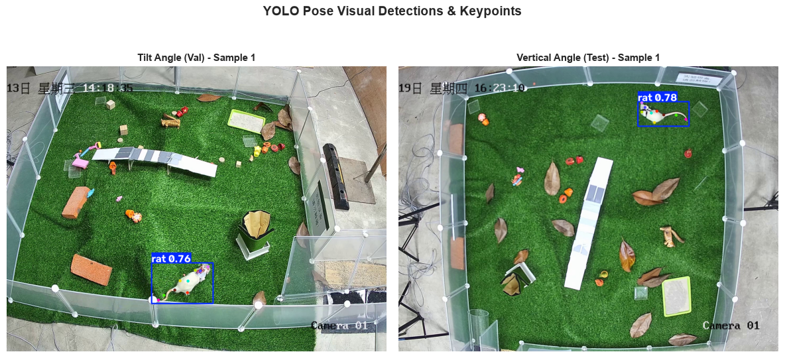
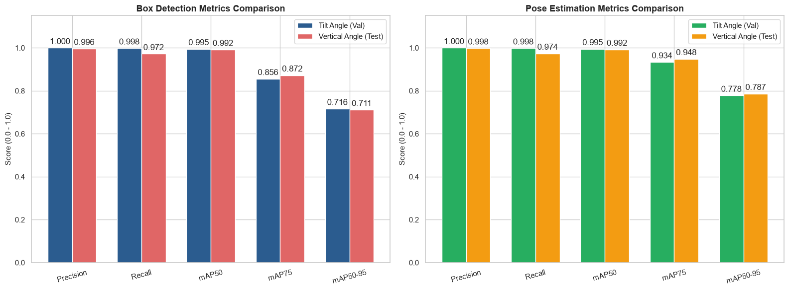
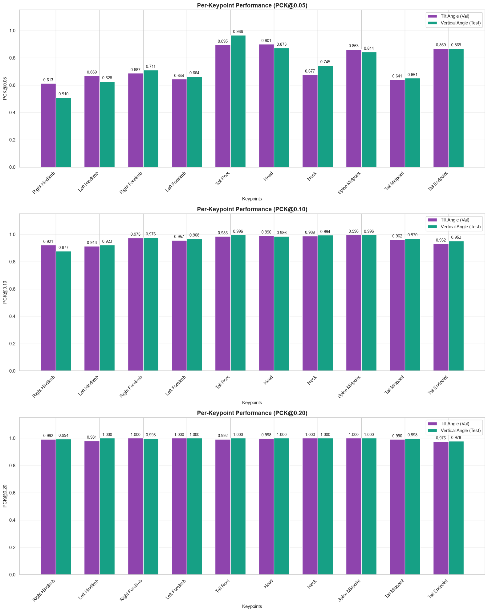
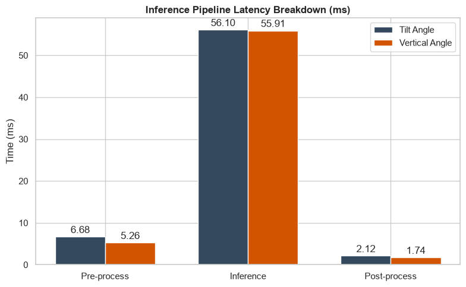

# What If You Want To Investigate The Impact Of Changes In Camera Angle On The Performance Of A YOLO Pose Estimation Model In Similar Enviroment ?

# Rat YOLO Pose Estimation

This project fine-tunes the pretrained `yolo26s-pose.pt` model for rat detection and 10-keypoint pose estimation in a lawn. It is trained and validated on images captured from the tilted camera view, then tested on a test set captured from the vertical view to compare performance across angles.

# Results:
* **sample visualization**


### 1. Overall Performance

* **Box Detection (`Box Metrics`):** Overall accuracy remained high across both camera angles, with Precision showing a minor change from `1.000` to `0.996` and `mAP50` remaining nearly the same (`0.995` to `0.992`).`mAP75` increased slightly (`0.856` to `0.872`). There was a slight reduction in Recall (from `0.998` to `0.972`) and in `mAP50-95` (from `0.716` to `0.711`).


* **Pose Estimation (`Pose Metrics`):** The vertical view showed strong overall keypoint localization performance. High precision was maintained (`1.000` to `0.998`), and `mAP50` remained virtually unchanged (`0.995` vs `0.992`). Higher-threshold metrics showed slight gains: `mAP75` rose from `0.934` to `0.948`, and overall `mAP50-95` increased slightly from `0.778` to `0.787`, alongside a small decrease in Recall (from `0.998` to `0.974`).



---

### 2. Analysis per Key Point  

**(PCK@0.05):**
* **Torso, Forelimbs & Tail:** The vertical view may have provided a clearer view along the longitudinal axis; notable improvements were observed for `Tail Root` (increasing from `0.895` to `0.966`) and `Neck` (from `0.677` to `0.745`). Slight increases were also recorded for `Right Forelimb` (from `0.687` to `0.711`), `Left Forelimb` (from `0.644` to `0.664`), and `Tail Midpoint` (from `0.641` to `0.651`), while `Tail Endpoint` remained `0.869` for both.


* **Hind Limbs, Head & Spine:** `Right Hindlimb` decreased from `0.613` to `0.510` and `Left Hindlimb` from `0.669` to `0.628`. Slight drops were also observed in `Head` (from `0.901` to `0.873`) and `Spine Midpoint` (from `0.863` to `0.844`).

**(PCK@0.10 and PCK@0.20):**
 * **PCK Threshold Progression:** At more relaxed thresholds (0.10 , 0.20), accuracy across both camera views approaches very high levels (> $0.95$ for most keypoints), which appears to indicate that localization errors in the vertical view might be minor spatial shifts rather than fundamental misidentifications.

 

---

### 3. Operational Efficiency (Pipeline Latency)
The total pipeline processing time appears highly consistent across both camera configurations:

* **Tilt Angle Latency:** Total pipeline processing time is estimated at approximately `64.90 ms` per image, consisting of `6.68 ms` for pre-processing, `56.10 ms` for model inference, and `2.12 ms` for post-processing.


* **Vertical Angle Latency:** Total pipeline processing time is estimated at approximately `62.91 ms` per image, consisting of `5.26 ms` for pre-processing, `55.91 ms` for model inference, and `1.74 ms` for post-processing.

**Interpretation:** The slight difference between the two setups indicates that changing the viewing angle seems to has a minimal effect on response time.



## Overview

The repository includes:

- dataset configuration from `config.yaml`
- Data utilities for preparing the data and annotation conversion in `src/rat_yolo_pose_estimation/data/`.
- Model training, validation, and comparison logic including PCK metrics in `src/rat_yolo_pose_estimation/model/`.
- A `rat_yolo_pose_estimation` command-line interface for training, validation, and comparison. Go to `CLI usage` section for more details.
- Tests for data preparation, label handling, and evaluation metrics.

And the `Notebooks/` directory.
## Notes 
- Data was prepared in `Notebooks/EDA.ipynb`.
- The model was trained in Google Colab; the training notebook can be found at `Notebooks/train.ipynb`, and the training outputs/weights are stored in the `runs/` folder.
- Comparison was done in in `Notebooks/compare.ipynb`.
- The reason why I didn't just stick to Notebooks and created `rat_yolo_pose_estimation` package is to facilitate potential future expansions, for example, to train on the other camera angle in Lawn scenarios or evaluate in a different environment. Furthermore, separating the logic from `Notebooks/` makes the project easier to reuse, maintain, and scale in the future.

## Requirements

This project targets Python 3.13 and installs dependencies from `pyproject.toml`.

```powershell
python -m pip install -e .
```

Included dependencies cover PyTorch, Ultralytics, OpenCV, pandas, NumPy, PyYAML, and plotting libraries.

## Project structure: 
An overview of the main directories and core components

```text
.
├── .github/workflows/ci.yml        # CI workflow
├── config.yaml                     # dataset configuration
├── data/                           # dataset (locally, not commited)
├── Notebooks/                     
│   ├── compare.ipynb
│   ├── EDA.ipynb
│   └── train.ipynb
├── runs/                            # (not commited)
├── src/
│   └── rat_yolo_pose_estimation/
│       ├── __main__.py              # -m entry point
│       ├── cli.py                   # command-line interface
│       ├── config.py                # default paths and config helpers
│       ├── data/
│       │   ├── data_prep.py         # data preparation
│       │   └── yolo_labels.py       # label handling
│       ├── inference/
│       │   └── inference.py         
│       └── model/
│           ├── compare.py            # model comparison utilities
│           ├── metrics.py            # evaluation metrics
│           ├── train.py              # YOLO training 
│           └── validate.py           # model validation 
├── tests/                            
│   ├── test_data_prep.py
│   ├── test_yolo_labels.py
│   └── test_evaluation_metrics.py
├── .dockerignore                    # files excluded from Docker builds
├── .gitignore                       # files excluded from Git
├── .python-version                  # required Python version
├── dockerfile                       # container build definition
├── pyproject.toml                   # package metadata and CLI entry point
├── README.md
└── uv.lock                          # locked dependency versions
```

## Dataset layout

dataset configuration is defined in `config.yaml` with paths relative to the project root:

```yaml
path: data

train: images/train
val: images/val
test: images/test
```

Expected structure:

```text
data/
├── images/
│   ├── train/   
│   ├── val/     
│   └── test/  
└── labels/
    ├── train/
    ├── val/
    └── test/
```

## Splitting:
```text
train: 2105 images (Tilt)
val: 527 images    (Tilt)
```
```text
test: 519 images (Verticl)
```
## CLI usage

Install the package first:

```powershell
python -m pip install -e .
```

The package exposes the `rat_yolo_pose_estimation` entry point from `pyproject.toml`.

### Train a model

```powershell
rat_yolo_pose_estimation train --config config.yaml --model weights/yolo26s-pose.pt
```

### Validate a model

```powershell
rat_yolo_pose_estimation validate --config config.yaml --model runs/pose/train/weights/best.pt --split val
```

### Compare validation and test performance

```powershell
rat_yolo_pose_estimation compare --config config.yaml --model runs/pose/train/weights/best.pt
```

### Supported commands

- `train`
- `validate` (reports the extracted metrics)
- `compare`  (evaluates the model on both the validation and test splits. reports the extracted metrics and per-keypoint, mean PCK results for each split)
---

`--split` is an optional argument for the `validate` command. It accepts `val` or `test` and defaults to `val`.


## Running tests

From the repository root:

```powershell
python -m pytest
```

## Data Source

This yolo pose estimation project uses the **Lawn scenarios** subset of the **UDARP-9.4K** dataset 

* **Dataset:** UDARP-9.4K
* **Source:** https://github.com/LeHan-ZJU/UDARP-9.4K
* **subset:** Lawn scenarios
* **Authors:** Le Han, Kaixuan Chen, Lei Zhao, Yangbo Jiang, Pengfei Wang, and Nenggan Zheng
* **License:** [CC BY 4.0](https://creativecommons.org/licenses/by/4.0/)
* **Paper:** *Cross-Domain Animal Pose Estimation With Skeleton Anomaly-Aware Learning*
* **DOI:** https://doi.org/10.1109/TCSVT.2025.3557844


**Modifications:**

* Images with missing annotations were removed
* Annotations that did not meet the applied validation criteria were removed, along with their associated images
* The desired images and their corresponding annotations from the dataset were converted into the YOLO pose format, and placed into the `data/` directory.
* For the labels: if the keypoint [x,y,v] has non-zero x,y coordinates, v=0 is converted to v=2 (reason & details in EDA.ipynb)
* applied data aumgmentation during training.

**Modifications and implementation details:**

* Data preparation and annotation conversion: `Notebooks/EDA.ipynb`, `src/rat_yolo_pose_estimation/data/`
* Data augmentation: `Notebooks/train.ipynb`, `src/rat_yolo_pose_estimation/model/train.py`


> **Disclaimer:** This project is independent and is not affiliated with, sponsored by, or endorsed by the original dataset authors.

### Citation

```bibtex
@ARTICLE{10949647,
  author={Han, Le and Chen, Kaixuan and Zhao, Lei and Jiang, Yangbo and Wang, Pengfei and Zheng, Nenggan},
  journal={IEEE Transactions on Circuits and Systems for Video Technology},
  title={Cross-Domain Animal Pose Estimation With Skeleton Anomaly-Aware Learning},
  year={2025},
  volume={35},
  number={9},
  pages={9148-9160},
  doi={10.1109/TCSVT.2025.3557844}
}
```
